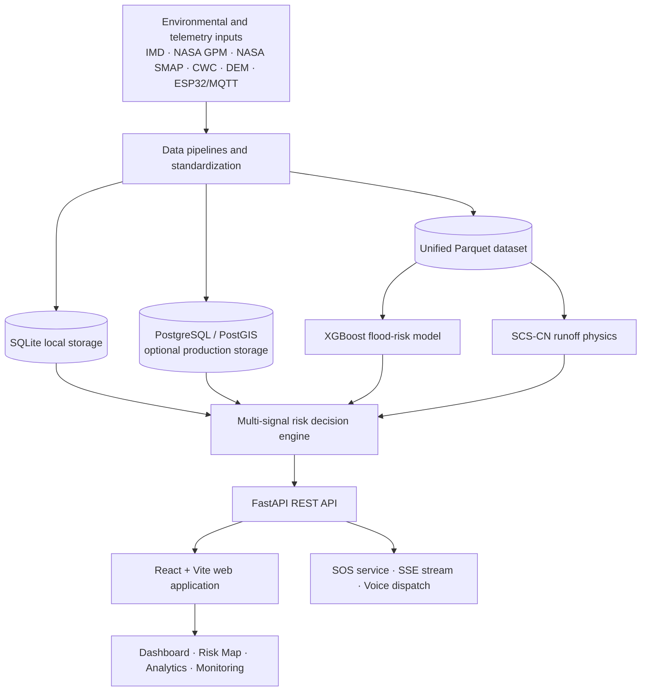

# 🌊 Jal Drishti (जल दृष्टि) — Flash Flood Early Warning & Disaster Intelligence Platform

> **See the risk. Act before the flood.**

Jal Drishti is a state-wide **Flash Flood Early Warning and Disaster Intelligence Platform** designed for **Uttarakhand, India**, with a focus on the Alaknanda, Bhagirathi, Mandakini, Pindar, and Ganga catchments.

The platform brings together rainfall and soil-moisture data, river-gauge telemetry, hydrological runoff calculations, machine-learning predictions, official disaster alerts, and emergency response workflows to help identify and communicate potential flash-flood risks.

It combines **XGBoost predictions**, **SCS-CN hydrological physics**, **Central Water Commission (CWC) river-stage thresholds**, geospatial visualization, and an **Emergency SOS and automated voice-dispatch workflow**.

---

## 🔗 Project Links

* 🌐 **Live Application:** Add deployment URL
* 📘 **API Documentation:** `http://127.0.0.1:8000/docs` (local development)
* 📦 **Repository:** Add repository URL

> Replace the placeholders above when the project is deployed or published.

---

## 🧰 Tech Stack


### Main Technologies

| Layer                     | Technologies                                                        |
| ------------------------- | ------------------------------------------------------------------- |
| Backend API               | Python 3.11+, FastAPI, Uvicorn, Pydantic v2, SQLAlchemy 2.0         |
| Frontend                  | React 18.3, Vite 5.4, Tailwind CSS 3.4, Framer Motion, Lucide Icons |
| Data Storage              | SQLite, PostgreSQL, PostGIS, TimescaleDB                            |
| Data Processing           | Pandas, NumPy, Apache Parquet, GeoPandas, Shapely                   |
| Machine Learning          | XGBoost 2.1, Scikit-learn, Joblib                                   |
| Hydrological Calculations | SCS-CN runoff model                                                 |
| Maps and Visualization    | Leaflet, React-Leaflet, MapLibre GL, Three.js, Recharts             |
| AI and Voice Dispatch     | Google Gemini 1.5 Flash, Twilio Voice API                           |
| Authentication            | JWT, PyJWT, Bcrypt, HTTP-only cookies                               |
| IoT and Edge              | ESP32 ultrasonic river sensor, MQTT, BLE Mesh relay                 |
| Testing                   | Pytest                                                              |

---

## 🎯 What Is Jal Drishti?

Flash floods in Himalayan catchments can develop rapidly. Steep terrain can move runoff into river channels quickly, while a gauge-only system may not capture every upstream tributary event. Rainfall forecasts alone can also produce misleading alerts if soil saturation and catchment retention are not considered.

Jal Drishti is designed to support earlier, more informed risk assessment by combining multiple environmental and operational signals instead of relying on one source.

### The Platform Brings Together

* 🌧️ **Rainfall and Soil Moisture:** Data streams associated with IMD observations, NASA GPM IMERG precipitation, and NASA SMAP soil moisture.
* 🌊 **River-Stage Telemetry:** River-gauge observations and CWC warning, danger, and Highest Flood Level (HFL) thresholds.
* 🧮 **Hydrological Physics:** Soil Conservation Service Curve Number (SCS-CN) calculations to estimate direct surface runoff.
* 🧠 **Machine-Learning Predictions:** An XGBoost model that estimates flood risk from environmental and terrain features.
* 🗺️ **Geospatial Intelligence:** Interactive monitoring maps and 3D terrain visualization.
* 🚨 **Emergency Response:** SOS reporting, live incident streaming, response guidance, and voice-dispatch capabilities.
* 📡 **Official Alerts:** Ingestion of NDMA SACHET disaster alerts.

---

## ✨ Key Features

### 1. Multi-Signal Flood Risk Engine

The risk decision engine combines model probability, rainfall, soil saturation, terrain, and river-gauge telemetry into four operational risk tiers:

`LOW` · `MODERATE` · `HIGH` · `EXTREME`

It also applies priority rules for conflicting signals:

* **Hydrological Override:** A CWC Danger Level or HFL breach can escalate risk even when the local rainfall forecast is low.
* **Impending Surge Warning:** High model probability combined with intense rainfall can raise concern even when a downstream gauge is below its warning stage or unavailable.

### 2. Flash Flood Early Warning System (FFEWS)

* Risk summaries and warning indicators.
* Rainfall accumulation and catchment analytics.
* River-stage comparison against official thresholds.
* Model-based risk scoring for monitoring locations.

### 3. Interactive Geospatial Monitoring

* Interactive map views for monitoring locations across Uttarakhand.
* Risk-based map visualization.
* Leaflet and MapLibre GL map components.
* Three.js-based 3D catchment terrain visualization.

### 4. River Gauge and Sensor Monitoring

* CWC station catalog and gauge telemetry views.
* Latest river-stage and rainfall observations.
* Warning Level, Danger Level, and HFL comparisons.
* An ESP32 ultrasonic river-level sensor integration path through MQTT.

### 5. Emergency SOS and Incident Streaming

* Citizen SOS incident submission.
* Real-time Server-Sent Events (SSE) stream for SOS updates.
* BLE Mesh relay support for forwarding distress packets where cellular connectivity is unavailable.
* Live incident and rescue-triage workflow.

### 6. Immediate Actions and Voice Dispatch

* Emergency response action interface.
* Twilio Voice webhook integration for outbound calls.
* Google Gemini-powered conversational guidance configured for Hindi (`hi-IN`) and English (`en-IN`).
* Response workflows informed by disaster alerts and incident information.

> Availability of external services depends on their credentials, connectivity, configuration, and deployment environment.

### 7. Official Disaster Alert Ingestion

* NDMA SACHET RSS/CAP XML alert ingestion.
* Alert-informed tactical disaster action plans.
* API access to state-specific tactical plan information.

### 8. Authentication and Access Control

* User registration and login.
* JWT-based authentication.
* HTTP-only cookie storage.
* Password hashing with Bcrypt.
* Authenticated user profile endpoint and logout workflow.

---

# 📸 Screenshots

> Add your screenshots in this section. You can upload them to GitHub and use the resulting image URLs, or store them in a `docs/screenshots/` directory inside your repository.

### Landing Page


### Login and Signup


### Executive Dashboard


### Interactive Risk Map


### Immediate Actions and Emergency SOS


### FFEWS Analytics


### Historical Data


### 3D Terrain Visualization


---

## 🧠 Machine Learning & Hydrological Physics

### A. XGBoost Flood-Risk Model

The project manual identifies the XGBoost Champion Model as version **v6.1.0**.

* **Model File:** `data/processed/ml/models/final_flood_risk_model.joblib`
* **Feature Allowlist:** `data/processed/ml/model_feature_allowlist.json`
* **Default Decision Threshold:** `0.40`

Example model features include:

* `rainfall_1h_mm`
* `rainfall_3h_mm`
* `rainfall_24h_mm`
* `soil_saturation_index`
* `surface_soil_moisture_vol`
* `slope_deg`
* `elevation_m`
* `scs_direct_runoff_q_mm`
* `scs_peak_runoff_potential`

### B. SCS-CN Runoff Calculation

Jal Drishti uses the Soil Conservation Service Curve Number method to estimate potential direct runoff.

**Potential Maximum Retention**

$$
S = \frac{25400}{CN_{adj}} - 254
$$

**Initial Abstraction**

$$
I_a = 0.20 \times S
$$

**Direct Runoff**

$$
Q =
\begin{cases}
\frac{(P-I_a)^2}{P-I_a+S+10^{-6}}, & P > I_a \\
0, & P \leq I_a
\end{cases}
$$

The peak runoff potential is further adjusted using terrain slope and a Manning-related factor. The adjusted Curve Number accounts for antecedent moisture conditions: dry (AMC-I), normal (AMC-II), and wet (AMC-III).

### C. Decision Fusion

The model output is considered alongside physical runoff estimates, soil moisture, terrain, and gauge thresholds. This design helps the platform account for both rainfall-driven risk and river-stage evidence.

> Model outputs are decision-support signals, not a guarantee that a flood will or will not occur. Official emergency guidance and on-ground authorities remain important.

---

## 🔄 System Architecture & Data Flow



### Architecture Overview

1. **Data Ingestion:** Environmental, geospatial, river-stage, and sensor information enters the data pipelines.
2. **Standardization and Storage:** Data is processed and stored in Parquet and application databases.
3. **Risk Engine:** Machine-learning inference and hydrological calculations feed the multi-signal decision engine.
4. **API Layer:** FastAPI exposes the platform's REST endpoints.
5. **Presentation Layer:** The React application presents dashboards, maps, analytics, and monitoring pages.
6. **Emergency Workflows:** SOS, live incident streaming, and configured voice-dispatch integrations support response operations.

---

## 📁 Repository Structure

```text
JAL-DRISHTI/
├── app/
│   ├── api/
│   │   └── routes/
│   │       ├── auth.py
│   │       ├── risk.py
│   │       ├── sos.py
│   │       ├── immediate_actions.py
│   │       ├── ffews.py
│   │       ├── stations.py
│   │       ├── observations.py
│   │       ├── tactical_plan.py
│   │       └── ...
│   ├── core/
│   ├── db/
│   │   ├── database.py
│   │   ├── sos_database.py
│   │   └── models/
│   ├── schemas/
│   ├── services/
│   │   ├── risk_decision_engine.py
│   │   ├── prediction_service.py
│   │   ├── auth_service.py
│   │   └── sachet_service.py
│   └── main.py
├── data/
│   ├── processed/
│   │   └── ml/
│   │       └── models/
│   │           └── final_flood_risk_model.joblib
│   └── jal_drishti_app.db
├── frontend/
│   ├── src/
│   │   ├── components/
│   │   ├── context/
│   │   ├── pages/
│   │   │   ├── LandingPage.jsx
│   │   │   ├── DashboardPage.jsx
│   │   │   ├── ImmediateActionsPage.jsx
│   │   │   ├── AnalyticsPage.jsx
│   │   │   ├── StationMonitoringPage.jsx
│   │   │   ├── LoginPage.jsx
│   │   │   ├── SignupPage.jsx
│   │   │   └── UttarakhandTerrainMap.jsx
│   │   ├── App.jsx
│   │   └── index.css
│   ├── package.json
│   └── vite.config.js
├── ml/
│   └── physics.py
├── scripts/
│   ├── repair_ml_dataset.py
│   └── ml_pipeline/
├── tests/
├── requirements.txt
└── README.md
```

> This is a representative structure based on the supplied project manual. The repository may contain additional files and modules.

---

## ⚙️ Setup & Run Locally

### Prerequisites

Install the following before starting:

* **Python 3.11 or later**
* **Node.js 18 or later**
* **npm 9 or later**
* Git (recommended)
* Optional: PostgreSQL with PostGIS for a production-oriented database setup

The supplied project manual describes SQLite as the local fallback when PostgreSQL is not configured.

### Step 1: Clone the Repository

```bash
git clone <YOUR_REPOSITORY_URL>
cd JAL-DRISHTI
```

Replace `<YOUR_REPOSITORY_URL>` with your actual repository URL.

### Step 2: Set Up the Backend

Create and activate a virtual environment.

**Windows PowerShell**

```powershell
python -m venv .venv
.\.venv\Scripts\Activate.ps1
pip install -r requirements.txt
```

Start the FastAPI server:

```powershell
python -m uvicorn app.main:app --host 127.0.0.1 --port 8000 --reload
```

**Backend Base URL**

```text
http://127.0.0.1:8000
```

**Interactive API Documentation**

```text
http://127.0.0.1:8000/docs
```

### Step 3: Set Up the Frontend

Open a second terminal:

```bash
cd frontend
npm install
npm run dev
```

Vite's default local address:

```text
http://localhost:5173
```

The frontend configuration is described as proxying `/api` requests to the backend on port `8000`.

### Step 4: Configure External Services

Some integrations may require environment variables or credentials, depending on the enabled features and local configuration:

* Google Gemini API credentials.
* Twilio account and voice configuration.
* Database connection settings for PostgreSQL/PostGIS.
* External environmental-data services, where applicable.

**Do not commit API keys, passwords, tokens, or production secrets to the repository.** Use environment variables and a local `.env` file excluded by `.gitignore`. Check the project's configuration files for the exact variable names required by your version.

---

## 🔌 REST API Reference

The following endpoints are listed in the supplied project manual.

| Method | Endpoint                                  | Purpose                                                    |
| ------ | ----------------------------------------- | ---------------------------------------------------------- |
| `GET`  | `/api/v1/health`                          | System health and model-loading status                     |
| `POST` | `/api/v1/auth/register`                   | Register a user                                            |
| `POST` | `/api/v1/auth/login`                      | Authenticate a user                                        |
| `GET`  | `/api/v1/auth/me`                         | Retrieve the active user's profile                         |
| `POST` | `/api/v1/auth/logout`                     | Clear the authentication cookie                            |
| `GET`  | `/api/v1/risk/summary`                    | Retrieve a multi-signal risk summary and alert counts      |
| `GET`  | `/api/v1/risk/offline`                    | Batch risk assessments for monitoring points               |
| `POST` | `/api/v1/predictions/score`               | Score supplied sensor parameters using the ML model        |
| `GET`  | `/api/v1/stations`                        | Retrieve the CWC station catalog                           |
| `GET`  | `/api/v1/observations/latest`             | Retrieve latest river-stage and rainfall observations      |
| `GET`  | `/api/v1/sos/stream`                      | Receive the live SOS stream using SSE                      |
| `POST` | `/api/v1/sos/report`                      | Submit an SOS incident                                     |
| `POST` | `/api/v1/immediate-actions/call/dispatch` | Dispatch an emergency call through configured integrations |
| `GET`  | `/api/v1/tactical-plan/{state_name}`      | Retrieve a state disaster tactical action plan             |
| `GET`  | `/api/v1/ffews/analytics`                 | Retrieve FFEWS risk curves and analytics                   |

For the full interactive API reference, start the backend and visit `http://127.0.0.1:8000/docs`.

---

## 🖥️ Operational Web Pages

| Page / Route         | Description                                                                                   |
| -------------------- | --------------------------------------------------------------------------------------------- |
| `/`                  | Public landing page, system overview, live status, emergency quick dials, and terrain preview |
| `/login`             | User login                                                                                    |
| `/signup`            | User registration                                                                             |
| `/dashboard`         | Executive command center with KPIs and risk map                                               |
| `/immediate-actions` | Emergency actions, voice-dispatch workflow, and rescue triage                                 |
| `/analytics`         | Rainfall accumulation, moisture indicators, and FFEWS analytics                               |
| `/monitoring`        | River gauge stages and official threshold comparisons                                         |
| `/about-terrain`     | Interactive 3D catchment terrain visualization                                                |

---

## 🚨 Risk Levels

Jal Drishti uses four standardized operational risk tiers:

| Risk Tier  | General Interpretation                                               |
| ---------- | -------------------------------------------------------------------- |
| `LOW`      | Current signals indicate a lower assessed risk                       |
| `MODERATE` | Conditions should be monitored for potential deterioration           |
| `HIGH`     | Elevated risk warrants attention and readiness                       |
| `EXTREME`  | Critical conditions require urgent attention and response procedures |

These labels describe the platform's assessment tiers. Actual operational decisions should follow validated system configuration and guidance from the responsible authorities.

---

## 🔐 Security & Responsible Use

The project includes or is designed around the following safeguards:

* JWT-based authentication.
* Bcrypt password hashing.
* HTTP-only cookie storage for authentication.
* Pydantic request/response validation.
* Separation of API routes, schemas, services, and database models.
* No plaintext password storage.
* Secret management through environment configuration.

### Important Operational Note

Jal Drishti is a disaster-intelligence and decision-support platform. Its predictions and automated messages should not be treated as a substitute for official warnings, emergency services, or decisions made by authorized disaster-management personnel.

Validate data sources, thresholds, model performance, and communications integrations before operational deployment.

---

## 🧪 Testing

The repository includes a `tests/` directory and uses **Pytest** for automated testing.

Run the project's tests from the repository root:

```bash
pytest
```

If the test environment requires optional services, datasets, or credentials, configure those prerequisites first and follow any project-specific test instructions.

---

## 🚧 Project Status

**Development Status: In Progress**

The supplied project manual documents the platform architecture, risk engine, web views, APIs, and external integrations. The actual availability of each feature depends on the current code, data, configuration, credentials, and deployment environment.

### Main Workstreams

* [x] Define the multi-signal flood-risk approach.
* [x] Establish the FastAPI and React application architecture.
* [x] Document the machine-learning and SCS-CN physics components.
* [x] Define API routes for risk, monitoring, authentication, and SOS workflows.
* [ ] Validate all environmental data pipelines end to end.
* [ ] Verify model performance against held-out and historical flood events.
* [ ] Validate river thresholds and station metadata with authoritative sources.
* [ ] Test SOS and voice-dispatch integrations in a safe test environment.
* [ ] Complete end-to-end, security, and accessibility testing.
* [ ] Configure production infrastructure and monitoring.
* [ ] Deploy and conduct operational validation.

> Update this checklist to reflect the exact state of the repository before publishing the README.

---

## 🗺️ Core Workflow

```text
Environmental Data + River Gauges + IoT Telemetry + Official Alerts
                              │
                              ▼
                   Data Processing Pipelines
                              │
                              ▼
                Parquet / SQLite / PostgreSQL
                              │
                 ┌────────────┴────────────┐
                 ▼                         ▼
          XGBoost Model              SCS-CN Physics
                 └────────────┬────────────┘
                              ▼
                 Multi-Signal Risk Engine
                              │
                              ▼
                         FastAPI
                              │
                              ▼
                     React Web Platform
                              │
          ┌───────────────────┼───────────────────┐
          ▼                   ▼                   ▼
      Dashboard         Maps & Analytics     Gauge Monitoring
                              │
                              ▼
                 SOS & Emergency Workflows
```

---

## 📚 Documentation

Project documentation and implementation references include:

* `PRD.md` — Product Requirements Document.
* `ARCHITECTURE.md` — System architecture and data flow.
* `requirements.txt` — Python backend dependencies.
* `frontend/package.json` — Frontend dependencies and scripts.
* `frontend/vite.config.js` — Frontend development-server configuration.
* **FastAPI Swagger UI** — Interactive API documentation at `/docs`.

---

## 🌍 Project Scope

Jal Drishti is focused on flash-flood early warning and disaster intelligence for Uttarakhand's Himalayan river catchments. Its goal is to connect environmental monitoring and risk estimation with clear operational views and emergency-response workflows.

The project brings together hydrological modeling, machine learning, geospatial visualization, sensor telemetry, and incident-response tooling in one platform.

---

## 📄 License

No license has been specified in the supplied project details. Add a `LICENSE` file and update this section if you intend to distribute the project under an open-source license.

---

<p align="center">
  <b>JAL DRISHTI · जल दृष्टि</b><br>
  <i>See the risk. Act before the flood.</i><br>
  Flash Flood Early Warning & Disaster Intelligence Platform
</p>
